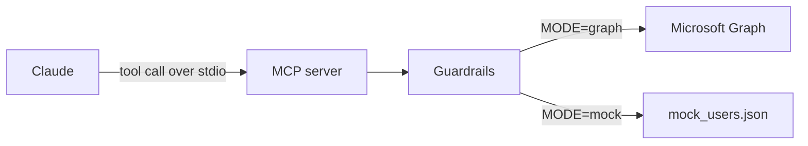

# M365 Admin MCP Server

[](https://github.com/Tanarius/m365-admin-mcp/actions/workflows/tests.yml)

An MCP server that lets Claude answer Microsoft 365 and Entra ID admin questions through Microsoft Graph.

It gives an AI assistant read-only access to admin data, with limits on what it can see and a log of everything it asks.


## Why I built this

At an MSP I check MFA gaps and stale accounts across many tenants. I wanted to see if an AI could do that safely.

## Demo

Screenshot: 


## What it does

Four tools. All of them only read data.

| Tool | Example question | Graph call | Needs Entra ID P1 |
| --- | --- | --- | --- |
| `get_user(upn)` | "Tell me about jane@contoso.com" | `GET /users/{upn}`, `/memberOf`, `/licenseDetails` | No |
| `license_summary()` | "How many E3 licenses are left?" | `GET /subscribedSkus` | No |
| `list_users_without_mfa()` | "Who isn't set up for MFA?" | `GET /reports/authenticationMethods/userRegistrationDetails` | Yes |
| `find_inactive_users(days=90)` | "Who hasn't signed in for 90 days?" | `GET /users?$filter=signInActivity/lastSignInDateTime le {date}` | Yes |

Each tool is marked read-only and non-destructive in its MCP annotations, so the client knows it can't change anything.

## How it works



1. Claude picks a tool based on its description and sends the call to the server.
2. The server checks the inputs, then asks a backend for the data.
3. In graph mode, the backend signs in as an Entra app registration and checks the token came from the right tenant.
4. The guardrails trim the fields, cap the rows, and write one line to the audit log.
5. Claude gets a short JSON answer and replies in plain English.

`MODE` in `.env` picks the backend. Mock mode reads a fake 10-user tenant, so you can run everything without a Microsoft account.

## Guardrails

| Guardrail | What it does |
| --- | --- |
| Read-only permissions | The app registration only has `.Read.All` permissions, and the code only sends GET requests. Microsoft refuses a write even if one were attempted. |
| Tenant lock | The server reads the tenant ID from the access token and won't start if it doesn't match `TENANT_ID` in `.env`. |
| Result cap | Each tool returns 25 rows at most and says when the list was cut. |
| Field trimming | Tools return a fixed set of fields. No phone numbers or addresses. |
| Audit log | Each tool call adds a line to `audit.log`: time, tool, inputs, row count, success or error. It logs counts, not user data. |
| Secrets out of code | The client secret is kept in `.env`, which is in `.gitignore`. |

## Permissions

All four are Microsoft Graph application permissions. All are read-only.

| Permission | Used by | Why |
| --- | --- | --- |
| `User.Read.All` | `get_user`, `find_inactive_users` | Read user profiles and license details |
| `GroupMember.Read.All` | `get_user` | Read the groups a user belongs to |
| `Organization.Read.All` | `license_summary` | Read the tenant's license SKUs |
| `AuditLog.Read.All` | `list_users_without_mfa`, `find_inactive_users` | Read MFA registration and sign-in activity |

## Quickstart in mock mode

No Microsoft account needed. You need Python 3.11 or later and [uv](https://docs.astral.sh/uv/).

```bash
git clone https://github.com/Tanarius/m365-admin-mcp.git
cd m365-admin-mcp
uv sync
```

Copy `.env.example` to `.env`. It is already set to `MODE=mock`.

Try the tools in the MCP Inspector:

```bash
uv run mcp dev server.py
```

To use it from Claude Desktop, add this to `claude_desktop_config.json` (Settings, Developer, Edit Config). Change the path to where you cloned the repo, then fully quit and reopen Claude Desktop.

```json
{
  "mcpServers": {
    "m365-admin": {
      "command": "uv",
      "args": ["--directory", "C:\\path\\to\\m365-admin-mcp", "run", "server.py"],
      "env": { "MODE": "mock" }
    }
  }
}
```

If Claude Desktop can't find `uv`, use the full path to `uv.exe` as the `command`.

For Claude Code:

```bash
claude mcp add m365-admin -e MODE=mock -- uv --directory /path/to/m365-admin-mcp run server.py
```

Then ask Claude "Who isn't set up for MFA?"

## Connecting to a real test tenant

Use a test tenant you own, never a production or client tenant. Two tools need Entra ID P1. A Microsoft 365 Business Premium trial includes it.

1. In the [Entra admin center](https://entra.microsoft.com), go to App registrations and create a new registration. Single tenant, no redirect URI.
2. Under API permissions, add the four Microsoft Graph application permissions listed above. Use application permissions, not delegated.
3. Grant admin consent. This needs a Global Administrator.
4. Under Certificates and secrets, create a client secret. Copy the value now. It is only shown once.
5. Fill in `.env`:

   ```
   MODE=graph
   TENANT_ID=<Directory (tenant) ID>
   CLIENT_ID=<Application (client) ID>
   CLIENT_SECRET=<secret value>
   ```

   `TENANT_ID` must be the GUID, not the domain name. Both IDs are on the app's Overview page.

6. Check that it starts: `uv run python server.py`. No output means it signed in and is waiting for a client. Press Ctrl+C to stop it. A bad `.env` or a tenant mismatch prints an error and exits.

## Running tests

```bash
uv run pytest
```

There are 26 tests. They cover all four tools in mock mode, the row cap, field trimming, the audit log, the tool annotations, and the Graph backend against simulated Graph responses (tenant lock, 403, the P1 license error, paging, 404). They need no Microsoft account. GitHub Actions runs them on every push.

## Known limitations

- `find_inactive_users` doesn't list users who have never signed in. Graph has no sign-in date for them to filter on.
- A stolen client secret bypasses this server's guardrails. Someone with the secret can call Graph directly, so the tenant lock, row cap, trimming, and audit log don't apply. Only the read-only permissions in Entra limit what they can do. If a secret leaks, delete it in Entra right away.
- Two tools need Entra ID P1. Without it, Graph refuses the request and the tool says so.
- Graph throttling (429) returns an error instead of retrying.

## Roadmap

Left out of v1 on purpose. Details in [NEXT.md](NEXT.md).

- Refuse to start if the app registration has any write permission
- Use a certificate instead of a client secret
- Rotate the audit log
- A password reset tool with a human approval step, in its own app registration
- Options to include never-signed-in users and skip disabled accounts
- Friendly license names, such as "Microsoft 365 E3" next to `SPE_E3`
- Retry on 429 using the `Retry-After` time

## Project layout

| Path | What it is |
| --- | --- |
| `server.py` | The MCP server and the four tools |
| `guardrails.py` | Field trimming, row cap, audit log |
| `mock_backend.py` | Fake tenant, read from `mock_users.json` |
| `graph_backend.py` | Real tenant, through Microsoft Graph |
| `config.py` | Settings from `.env` |
| `tests/` | pytest tests |

Built on the official [MCP Python SDK](https://github.com/modelcontextprotocol/python-sdk), version 2.

## License

MIT. See [LICENSE](LICENSE).

---

Built with Claude Code. I designed the guardrails, tested every tool, and verified it against a live tenant." I'll update your resume to match.
